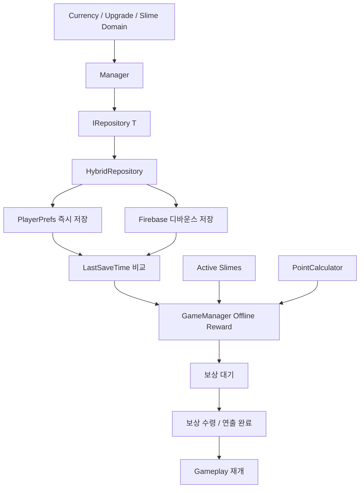

# Monster Kindergarten — Code Samples

1인 개발 Android 방치형 클리커 게임에서 게임 규칙과 저장 구현을 분리하고, 로컬·Firebase 동기화와 오프라인 보상 흐름을 구성한 핵심 코드 샘플입니다.

## 프로젝트 정보

| 항목 | 내용 |
|---|---|
| 개발 형태 | 1인 개발 |
| 개발 시기 | 2026.01.26 ~ 2026.02.10 (초기 제작) / 2026.08 ~ 현재 (출시 개발) |
| 담당 범위 | 기획, Unity 클라이언트 개발, 데이터·저장 구조 설계, Android 인증·배포 연동 |
| 개발 환경 | Unity 6, C#, UniTask, Firebase Auth·Firestore, Google Play Games |
| 대상 플랫폼 | Android (Google Play 내부 테스트) |

## 핵심 문제

- 클릭·자동 획득·머지로 저장 요청이 자주 발생하는 문제
- 로컬 데이터와 Firebase 데이터의 저장 시점이 달라 충돌할 수 있는 문제
- Android 계정별 진행 데이터를 Firebase UID 기준으로 분리해야 하는 문제
- 미접속 시간만이 아니라 보유 슬라임의 성장 상태를 반영한 오프라인 보상이 필요한 문제
- 오프라인 보상 수령·연출 중 자동 생산과 스폰이 함께 진행되면 재화 흐름이 섞일 수 있는 문제

## 구조 요약

## 폴더

| 폴더 | 내용 |
|---|---|
| [SaveArchitecture](./SaveArchitecture/README.md) | Repository 추상화, 로컬 즉시 저장, Firebase 디바운스, 최신 데이터 선택 |
| [DomainArchitecture](./DomainArchitecture/README.md) | 재화·업그레이드·슬라임 상태의 핵심 규칙과 Manager 협력 |
| [GameplayLoop](./GameplayLoop/README.md) | 클릭·자동 생산·머지·스폰과 업그레이드 효과 연결 |
| [OfflineReward](./OfflineReward/README.md) | 마지막 저장 시각과 보유 슬라임 자동 생산량 기반 오프라인 보상 |
| [Feedback](./Feedback/README.md) | `IFeedback` 기반 컴포넌트 분리와 대표 스케일 피드백 구현 |

## 핵심 구현 기준 읽기 순서

### 저장 구조

1. [`IRepository.cs`](./SaveArchitecture/IRepository.cs)
2. [`HybridRepository.cs`](./SaveArchitecture/HybridRepository.cs)
3. [`CurrencyManager.cs`](./DomainArchitecture/CurrencyManager.cs)

### 오프라인 보상

4. [`GameManager.cs`](./OfflineReward/GameManager.cs)
5. [`PointCalculator.cs`](./GameplayLoop/PointCalculator.cs)
6. [`AutoClicker.cs`](./GameplayLoop/AutoClicker.cs)
7. [`SpawnManager.cs`](./GameplayLoop/SpawnManager.cs)

### 도메인 및 추가 구현

8. [`Currency.cs`](./DomainArchitecture/Currency.cs)
9. [`Upgrade.cs`](./DomainArchitecture/Upgrade.cs)
10. [`UpgradeManager.cs`](./DomainArchitecture/UpgradeManager.cs)
11. [`SlimeStatus.cs`](./DomainArchitecture/SlimeStatus.cs)
12. [`Clicker.cs`](./GameplayLoop/Clicker.cs)
13. [`MergeManager.cs`](./GameplayLoop/MergeManager.cs)
14. [`IFeedback.cs`](./Feedback/IFeedback.cs)
15. [`ScaleTweeningFeedback.cs`](./Feedback/ScaleTweeningFeedback.cs)

## 주요 의존성

- Unity 6
- UniTask
- Firebase Authentication / Firestore
- Google Play Games
- PlayerPrefs / JsonUtility
- DOTween 및 프로젝트 공용 풀 시스템

## 설계 포인트

- Manager와 Domain은 구체 저장 구현이 아니라 `IRepository<T>`에 의존합니다.
- 데이터 변경은 로컬에 즉시 저장하고 Firebase 요청은 디바운스로 합칩니다.
- `LastSaveTime`을 기준으로 로컬과 Firebase 데이터 중 최신 상태를 선택합니다.
- Android에서는 Firebase UID를 사용자 식별 기준으로 사용해 계정별 저장 데이터를 연결합니다.
- 오프라인 보상은 `보유 슬라임의 초당 자동 생산량 × 미접속 시간 × 보상 효율`로 계산합니다.
- 오프라인 보상이 존재하면 자동 생산과 스폰을 멈추고, 수령·연출이 완료된 뒤 Gameplay를 재개합니다.
- 온라인 자동 생산과 오프라인 생산량 계산은 동일한 `PointCalculator` 규칙을 사용합니다.

## 플랫폼 정책

- Android 실제 빌드: Firebase UID 기준 로컬 저장 + Firestore를 결합한 Hybrid Repository
- Editor / 비 Android 환경: 로컬 Repository로 개발·테스트
- 플랫폼별 저장 구현이 바뀌어도 Manager와 Domain의 게임 규칙은 유지

## 인증 구성

Google Play Games 로그인부터 Firebase Authentication, Firebase UID 연결까지의 환경 구성 과정은 개발 블로그에 정리했습니다.

- [Google Play Games · Firebase 인증 환경 구성 과정](https://velog.io/@gom_in/Monster-Kindergarten-1-Play-Games%EC%99%80-Firebase-%EC%9D%B8%EC%A6%9D-%ED%99%98%EA%B2%BD-%EA%B5%AC%EC%84%B1%ED%95%98%EA%B8%B0)

## 공개 범위

포트폴리오 저장소에는 저장 구조, 도메인 규칙, 플레이 루프와 오프라인 보상 설계를 이해하는 데 필요한 코드만 선별했습니다.  
Google Play Console 설정, Firebase 프로젝트 설정, 전체 UI·연출 구현, 프리팹과 기타 공용 시스템은 전체 프로젝트 및 개발 기록에서 확인할 수 있습니다.
