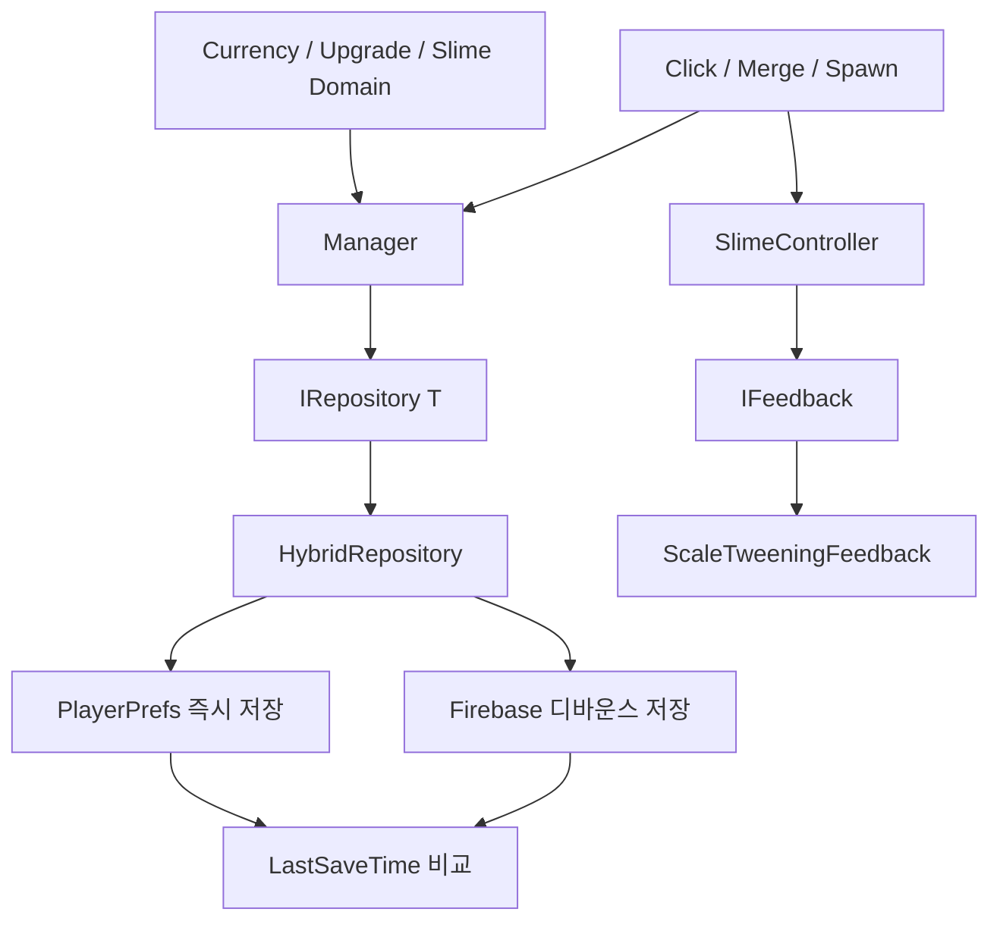

# Monster Kindergarten — Code Samples

1인 개발 클리커 게임에서 저장 방식과 게임 규칙을 분리하고, 빈번한 데이터 변경을 로컬과 Firebase에 안정적으로 반영하기 위해 구성한 코드입니다.

## 프로젝트 정보

| 항목 | 내용 |
|---|---|
| 개발 형태 | 1인 개발 |
| 개발 시기 | 2026.02 |
| 담당 범위 | 기획, Unity 클라이언트 개발, 데이터·저장 구조 설계 |
| 개발 환경 | Unity 6, C#, UniTask, Firebase Auth·Firestore |
| 대상 플랫폼 | Windows, WebGL |

## 핵심 문제

- 클릭·자동 획득·머지로 저장 요청이 매우 자주 발생하는 문제
- 로컬 데이터와 서버 데이터의 저장 시점이 달라 충돌할 수 있는 문제
- 플랫폼별 Firebase 사용 가능 여부가 다른 문제
- 재화·업그레이드·슬라임 상태 규칙이 UI와 저장 코드에 흩어지는 문제
- 클릭 피드백이 슬라임 처리 코드에 직접 결합될 경우 효과 추가마다 기존 코드를 수정해야 하는 문제

## 구조 요약

## 폴더

| 폴더 | 내용 |
|---|---|
| [SaveArchitecture](./SaveArchitecture/README.md) | Repository 추상화, 로컬 즉시 저장, Firebase 디바운스, 최신 데이터 선택 |
| [DomainArchitecture](./DomainArchitecture/README.md) | 재화·업그레이드·슬라임 상태의 핵심 규칙과 Manager 협력 |
| [GameplayLoop](./GameplayLoop/README.md) | 클릭·드래그·머지·스폰·업그레이드 효과 연결 |
| [Feedback](./Feedback/README.md) | `IFeedback` 기반 컴포넌트 분리와 대표 스케일 피드백 구현 |

## 권장 읽기 순서

### 저장 및 도메인 구조

1. [`IRepository.cs`](./SaveArchitecture/IRepository.cs)
2. [`HybridRepository.cs`](./SaveArchitecture/HybridRepository.cs)
3. [`Currency.cs`](./DomainArchitecture/Currency.cs)
4. [`Upgrade.cs`](./DomainArchitecture/Upgrade.cs)
5. [`UpgradeManager.cs`](./DomainArchitecture/UpgradeManager.cs)
6. [`SlimeStatus.cs`](./DomainArchitecture/SlimeStatus.cs)

### 플레이 루프와 피드백

7. [`Clicker.cs`](./GameplayLoop/Clicker.cs)
8. [`MergeManager.cs`](./GameplayLoop/MergeManager.cs)
9. [`SlimeController.cs`](./Feedback/SlimeController.cs)
10. [`IFeedback.cs`](./Feedback/IFeedback.cs)
11. [`ScaleTweeningFeedback.cs`](./Feedback/ScaleTweeningFeedback.cs)

## 주요 의존성

- Unity 6
- UniTask
- Firebase Auth / Firestore
- PlayerPrefs / JsonUtility
- DOTween 및 프로젝트 공용 풀 시스템

## 설계 포인트

- Manager와 Domain은 구체 저장 구현이 아니라 `IRepository<T>`에 의존합니다.
- 빈번한 데이터 변경은 로컬에 즉시 저장하고 Firebase 요청은 디바운스로 합칩니다.
- `LastSaveTime`을 기준으로 로컬과 서버 데이터 중 최신 상태를 선택합니다.
- 재화·업그레이드·슬라임 규칙을 Unity UI 및 저장 형식과 분리했습니다.
- 클릭 피드백은 `IFeedback` 구현 컴포넌트를 추가하는 방식으로 확장합니다.
- 풀링 오브젝트의 Tween은 비활성화 시 정리해 이전 효과가 남지 않도록 처리했습니다.

## 플랫폼 정책

- 에디터·일반 빌드: PlayerPrefs와 Firebase를 결합한 Hybrid Repository
- WebGL: Firebase 의존 코드를 제외하고 PlayerPrefs Repository 사용
- Manager와 Domain 코드는 저장 구현 교체의 영향을 받지 않도록 구성

## 공개 범위

포트폴리오 저장소에는 저장 구조, 도메인 규칙, 플레이 루프와 피드백 설계를 이해하는 데 필요한 코드만 선별했습니다.  
AudioManager, 전체 피드백 구현체, 프리팹 설정과 기타 공용 시스템은 전체 프로젝트 저장소에서 확인할 수 있습니다.
