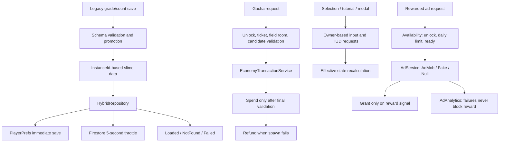

# 슬라임 유치원 (구 Monster Kindergarten) — Code Samples

1인 개발 Android 방치형 머지·수집 게임의 핵심 코드입니다. 단순 기능 나열보다, 콘텐츠가 늘어나는 과정에서 진행 데이터를 안전하게 확장하고 여러 UI·연출의 상태 충돌을 막은 설계 판단을 중심으로 선별했습니다.

## 프로젝트 정보

| 항목 | 내용 |
|---|---|
| 개발 형태 | 1인 개발 |
| 개발 시기 | 2026.01.26 ~ 2026.02.10 (초기 제작) / 2026.08 ~ 현재 (출시 개발) |
| 담당 범위 | 기획, Unity 클라이언트 개발, 데이터·저장 구조 설계, Android 인증·배포 연동 |
| 개발 환경 | Unity 6, C#, UniTask, Firebase Auth, Firestore, Firebase Analytics, Google Play Games, Google Mobile Ads |
| 대상 플랫폼 | Android |
| 최신 빌드 | `0.1.15` / Android Version Code `17` (2026-10-02 AAB 생성, 트랙 제출·기기 검증 대기) |

## 해결한 핵심 문제

- 개수만 저장하던 슬라임 데이터를 `InstanceId` 기반 개체 데이터로 승격하면서 기존 진행도를 유지했습니다.
- 로컬·클라우드 읽기 실패를 신규 데이터와 구분해, 읽지 못한 진행도를 첫 저장으로 덮어쓰지 않도록 했습니다.
- 클릭과 자동 생산으로 저장 요청이 계속 발생해도 Firestore 저장이 멈추지 않도록 debounce를 throttle로 교체했습니다.
- 가챠에서 티켓을 먼저 소비해 결과 생성 실패 시 재화를 잃는 순서를 제거했습니다.
- 장식장·튜토리얼·모달이 동시에 입력과 HUD를 제어해도 종료 순서에 따라 화면이 잠기지 않도록 owner 기반 요청으로 분리했습니다.
- 보상형 광고는 SDK 호출, 보상 규칙, 분석 기록을 나눠 광고나 분석이 실패해도 보상 지급과 게임 진행이 막히지 않도록 했고, 동의 전에는 광고 SDK가 초기화되지 않게 했습니다.

## 구조 요약

## 코드 사례

| 폴더 | 핵심 주제 |
|---|---|
| [SaveDataMigration](./SaveDataMigration/README.md) | v0 count 저장부터 v15까지의 스키마 승격과 상위 버전 차단 |
| [HybridRepository](./HybridRepository/README.md) | 로컬 우선 저장, 클라우드 throttle, 실패를 보존하는 로드 결과 |
| [GachaTransaction](./GachaTransaction/README.md) | 티켓 소비·슬라임 생성의 순서 보장과 실패 환불 |
| [InputUIState](./InputUIState/README.md) | owner·priority 기반 월드 입력과 HUD 상태 충돌 방지 |
| [CollectionData](./CollectionData/README.md) | 도감·플레이 기록 집계와 졸업 시점 통계 스냅샷 |
| [AdsAndAnalytics](./AdsAndAnalytics/README.md) | 보상형 광고 SDK 추상화, 보상 지급 규칙, Firebase Analytics 광고 지표, 동의 전 초기화 차단 |

## 권장 읽기 순서

1. [HybridRepository](./HybridRepository/README.md): 읽기 실패를 진행도 손실로 이어지지 않게 만든 저장 정책
2. [SaveDataMigration](./SaveDataMigration/README.md): 저장 구조가 확장될 때의 호환 전략
3. [GachaTransaction](./GachaTransaction/README.md): 게임플레이 보상에서 소비와 생성의 순서 보장
4. [InputUIState](./InputUIState/README.md): 기능 간 UI 상태 충돌을 줄인 방식
5. [CollectionData](./CollectionData/README.md): 누적 기록과 엔딩 통계를 도메인에 귀속한 방식
6. [AdsAndAnalytics](./AdsAndAnalytics/README.md): 외부 SDK가 실패해도 보상과 진행을 지키는 광고와 지표 연동

## 플랫폼 및 검증 범위

- Android에서는 Google Play Games 로그인 후 Firebase Authentication UID를 저장 소유자로 사용합니다.
- Editor와 비 Android 환경은 `LocalAccountRepository` 및 로컬 저장소로 동작합니다.
- 최신 릴리스 AAB는 생성했지만, `0.1.14`와 `0.1.15`에서 처음 들어간 기능의 실제 Android 기기 검증과 Play Console 제출은 별도 진행 항목입니다.

## 공개 범위

포트폴리오에는 본인이 작성한 핵심 코드와 이해에 필요한 최소 계약만 포함했습니다. 씬·프리팹·ScriptableObject, 외부 SDK, Firebase/Play Console 설정 및 전체 게임 에셋은 제외되어 샘플만으로 실행되지는 않습니다.

최신 원본 프로젝트: https://github.com/jjh770/MonsterKindergarten
