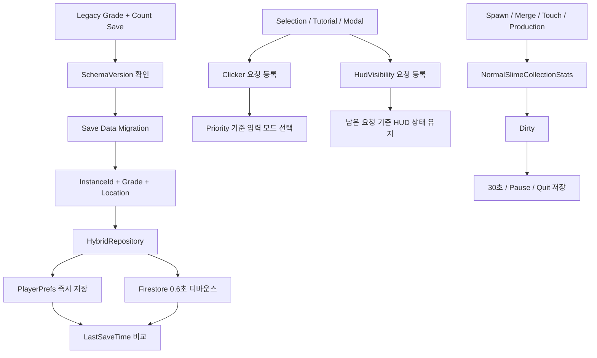

# Monster Kindergarten — Code Samples

1인 개발 Android 방치형 머지·수집 게임에서 콘텐츠 확장 과정에 맞춰 저장 구조를 개체 단위로 전환하고,
로컬·Firestore 저장, 입력·HUD 상태 관리, 도감 누적 기록 구조를 구성한 핵심 코드 샘플입니다.

## 프로젝트 정보

| 항목 | 내용 |
|---|---|
| 개발 형태 | 1인 개발 |
| 개발 시기 | 2026.01.26 ~ 2026.02.10 (초기 제작) / 2026.08 ~ 현재 (출시 개발) |
| 담당 범위 | 기획, Unity 클라이언트 개발, 데이터·저장 구조 설계, Android 인증·배포 연동 |
| 개발 환경 | Unity 6, C#, UniTask, Firebase Auth·Firestore, Google Play Games |
| 대상 플랫폼 | Android (Google Play 내부 테스트) |

## 핵심 문제

- 등급별 개수 저장만으로는 장식장에 이동한 동일 등급 슬라임을 개별적으로 구분하기 어려운 문제
- 저장 구조가 변경된 뒤에도 기존 사용자의 진행 데이터를 유지해야 하는 문제
- 클릭·자동 생산 등 잦은 데이터 변경마다 Firestore 저장을 요청하면 불필요한 쓰기가 반복되는 문제
- 장식장 선택·관찰, 튜토리얼, 모달 UI가 입력과 HUD 상태를 직접 변경하면서 종료 순서에 따라 상태가 잘못 복원될 수 있는 문제
- 도감에 자연 생성·머지·터치·생산량 등 누적 기록이 추가되면서 데이터 변경 빈도가 크게 늘어난 문제

## 구조 요약

## 폴더

| 폴더 | 내용 |
|---|---|
| [SaveDataMigration](./SaveDataMigration/README.md) | 등급별 Count 저장을 InstanceId 기반 개체 저장으로 전환하고 SchemaVersion 기반 마이그레이션을 수행합니다. |
| [HybridRepository](./HybridRepository/README.md) | PlayerPrefs 즉시 저장, Firestore 디바운스 저장, 병렬 로드와 최신 데이터 선택을 담당합니다. |
| [InputUIState](./InputUIState/README.md) | owner·priority 기반 입력 요청과 owner별 HUD 숨김 요청으로 기능 간 상태 충돌을 줄입니다. |
| [CollectionData](./CollectionData/README.md) | 도감의 등급별 누적 기록을 집계하고 Dirty 상태와 저장 주기로 저장 빈도를 관리합니다. |

## 핵심 구현 기준 읽기 순서

### 개체 저장과 마이그레이션

1. [`ISaveData.cs`](./SaveDataMigration/ISaveData.cs)
2. [`SlimeInstanceSaveData.cs`](./SaveDataMigration/SlimeInstanceSaveData.cs)
3. [`SlimeStatusSaveData.cs`](./SaveDataMigration/SlimeStatusSaveData.cs)
4. [`PlayerPrefsSlimeStatusRepository.cs`](./SaveDataMigration/PlayerPrefsSlimeStatusRepository.cs)
5. [`FirebaseSlimeStatusRepository.cs`](./SaveDataMigration/FirebaseSlimeStatusRepository.cs)

### 로컬·클라우드 저장

6. [`IRepository.cs`](./HybridRepository/IRepository.cs)
7. [`HybridRepository.cs`](./HybridRepository/HybridRepository.cs)

### 입력·UI 상태 관리

8. [`ClickerInputMode.cs`](./InputUIState/ClickerInputMode.cs)
9. [`Clicker.cs`](./InputUIState/Clicker.cs)
10. [`HudVisibility.cs`](./InputUIState/HudVisibility.cs)

### 도감 누적 기록

11. [`NormalSlimeCollectionStats.cs`](./CollectionData/NormalSlimeCollectionStats.cs)
12. [`SlimeManager.cs`](./CollectionData/SlimeManager.cs)

## 주요 의존성

- Unity 6
- UniTask
- Firebase Authentication / Firestore
- Google Play Games
- PlayerPrefs / Newtonsoft.Json
- DOTween 및 프로젝트 공용 풀 시스템

## 설계 포인트

- 같은 등급의 슬라임도 개별 위치와 정보를 유지할 수 있도록 `InstanceId` 기반 개체 저장 구조로 전환했습니다.
- `SchemaVersion`을 도메인별로 관리하고, 구버전 저장 데이터는 마이그레이션·정규화한 뒤 현재 구조로 다시 저장합니다.
- 현재 앱보다 높은 저장 버전은 이전 앱에서 덮어쓰지 않도록 로드를 차단합니다.
- 데이터 변경은 PlayerPrefs에 즉시 저장하고 Firestore 요청은 0.6초 디바운스로 합칩니다.
- 로드 시 PlayerPrefs와 Firestore를 병렬 조회하고 `LastSaveTime`을 기준으로 최신 진행 데이터를 선택합니다.
- 입력 상태는 owner별 요청과 `Space < Selection < Tutorial < Modal` 우선순위로 관리합니다.
- HUD는 owner별 숨김 요청을 누적해 다른 기능의 요청이 남아 있으면 숨김 상태를 유지합니다.
- 도감 누적 기록은 이벤트마다 즉시 저장하지 않고 Dirty 상태로 표시한 뒤 30초 주기와 Pause·Quit 시점에 저장합니다.

## 플랫폼 정책

- Android 실제 빌드: Firebase UID 기준 PlayerPrefs + Firestore를 결합한 Hybrid Repository
- Editor / 비 Android 환경: 로컬 Repository로 개발·테스트
- Google Play Games 로그인 → Firebase Authentication → Firebase UID를 사용자 데이터 식별 기준으로 사용
- 계정 삭제 시 Firebase Authentication 사용자, 현재 UID의 Firestore 진행 데이터, 로컬 진행·튜토리얼 데이터를 함께 삭제

## 인증 구성

Google Play Games 로그인부터 Firebase Authentication, Firebase UID 연결까지의 환경 구성 과정은 개발 블로그에 정리했습니다.

- [Google Play Games · Firebase 인증 환경 구성 과정](https://velog.io/@gom_in/Monster-Kindergarten-1-Play-Games%EC%99%80-Firebase-%EC%9D%B8%EC%A6%9D-%ED%99%98%EA%B2%BD-%EA%B5%AC%EC%84%B1%ED%95%98%EA%B8%B0)

## 공개 범위

포트폴리오 저장소에는 저장 구조, 마이그레이션, 입력·HUD 상태 관리, 도감 누적 기록 설계를 이해하는 데 필요한 코드만 선별했습니다.  
Google Play Console 설정, Firebase 프로젝트 설정, 전체 UI·연출 구현, 프리팹과 기타 공용 시스템은 전체 프로젝트 및 개발 기록에서 확인할 수 있습니다.

최신 원본 프로젝트:
https://github.com/jjh770/MonsterKindergarten
